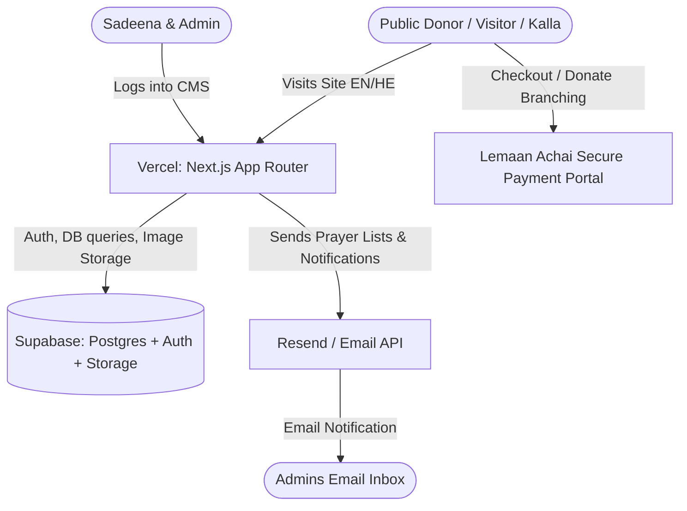

# Likrat Kalla Website — Architecture & Development Plan

## 1. Overview & Objectives

**Organization:** Likrat Kalla (under parent organization *Lemaan Achai*)  
**Mission:** 100% volunteer organization providing ~10 essential household gifts to needy brides (*kallas*) in Israel.  
**Goal:** Build a modern, bilingual (Hebrew & English), responsive website to replace the previous Wix site (`www.helpjewishbrides.org`), showcase the organization's work, facilitate 4 donation/sponsorship pathways branching into Lemaan Achai's secure payment system, and provide an easy-to-use Admin CMS for Sadeena and her husband to manage content, media, catalog items, anonymous bride profiles, prayer intentions, and seasonal event banners without code changes.

---

## 2. Architecture & Hosting Strategy Recommendation

### Comparison of Options

| Factor | Option A: Fullstack Next.js + Supabase + Vercel *(Recommended)* | Option B: Next.js (Vercel) + Express/NestJS (Railway) + Supabase | Option C: AWS All-In (S3, CloudFront, Lambda / Amplify, DynamoDB / RDS, Cognito) |
| :--- | :--- | :--- | :--- |
| **Monthly Cost** | **$0.00 / month** (All generous free tiers for low traffic) | $5 - $10+ / mo (Railway minimum charges for running backend containers) | $0 during Year 1, then $15–$30+/mo for managed DB / services |
| **Maintenance Overhead** | **Very Low** (Managed serverless, automated HTTPS, zero OS/container patching) | Medium (Need to maintain 2 separate deployments and keep container alive) | High (IAM policies, VPCs, certificates, CloudFront cache invalidation) |
| **Media & File Storage** | Supabase Storage (Built-in image transform, CDN, instant S3-compatible buckets) | Supabase Storage or Cloudinary | AWS S3 + CloudFront |
| **Admin Authentication** | Supabase Auth (Built-in Magic Link / Email+Password, Row Level Security) | Custom JWT or Supabase Auth | AWS Cognito or custom auth |
| **Developer Velocity** | **Fastest** (Unified TypeScript codebase, Next.js Server Actions / App Router) | Fast, but duplicate types/API endpoints | Slower setup and configuration |

### Final Architecture Recommendation
**Unified Fullstack Next.js (App Router, TypeScript, Tailwind CSS, shadcn/ui) + Supabase + Vercel + Resend (Emails)**

- **Frontend & API:** Next.js (React 19, App Router) hosted on **Vercel** (Hobby Free Tier).
- **Database, Auth & Media Storage:** **Supabase** (Free Tier: 500MB Postgres DB, 1GB File Storage for gallery/catalog pictures, Built-in Auth).
- **Transactional Email:** **Resend** or **SendGrid** Free Tier (to email prayer intentions and donor details immediately to admins).
- **Internationalization:** `next-intl` or built-in locale routing supporting **English (LTR)** and **Hebrew (RTL)** with seamless UI mirroring and font support (e.g. Heebo / Rubik).
- **Payment Processing:** Secure URL/form branching to **Lemaan Achai's Likrat Kalla** donation portal with pre-calculated amounts and tracking parameters.

---

## 3. Data Model Design (Supabase Postgres)

### Tables

1. **`site_content`**
   - `key` (TEXT, PK): Unique identifier (e.g., `landing_hero_title`, `about_story_text`, `contact_ivr_info`).
   - `locale` (TEXT, PK): `'en'` or `'he'`.
   - `value` (TEXT): Text content or HTML/Markdown.
   - `updated_at` (TIMESTAMPTZ).

2. **`site_media`**
   - `id` (UUID, PK).
   - `section` (TEXT): `'landing_carousel'`, `'about_gallery'`, `'events'`.
   - `category` (TEXT, Nullable): `'yearly_events'`, `'parlor_meetings'`, `'distribution_days'`, `'special_videos'`.
   - `media_type` (TEXT): `'image'` or `'video'` (YouTube/Vimeo embed URL or hosted mp4).
   - `url` (TEXT): Supabase storage URL or external video link.
   - `title_en` (TEXT), `title_he` (TEXT).
   - `display_order` (INT).
   - `is_active` (BOOLEAN).

3. **`catalog_items`**
   - `id` (UUID, PK).
   - `title_en` (TEXT), `title_he` (TEXT).
   - `description_en` (TEXT), `description_he` (TEXT).
   - `price_nis` (NUMERIC).
   - `image_url` (TEXT).
   - `category` (TEXT): `'core_package_item'` or `'random_choice_item'`.
   - `display_order` (INT).
   - `is_active` (BOOLEAN).

4. **`kallas` (Anonymous Brides for Sponsorship)**
   - `id` (UUID, PK).
   - `wedding_date` (DATE).
   - `story_en` (TEXT), `story_he` (TEXT).
   - `target_amount_nis` (NUMERIC, Default: 500).
   - `is_sponsored` (BOOLEAN, Default: false).
   - `created_at` (TIMESTAMPTZ).

5. **`prayer_reasons` (Tefillah Dropdown Options)**
   - `id` (UUID, PK).
   - `label_en` (TEXT): e.g., "Refuah Shleima", "Shidduch / Zivug", "Ilui Neshama", "Parnasah".
   - `label_he` (TEXT): e.g., "רפואה שלמה", "זיווג הגון", "לעילוי נשמת", "פרנסה טובה".
   - `display_order` (INT).
   - `is_active` (BOOLEAN).

6. **`prayer_submissions` (Donor Names & Intentions)**
   - `id` (UUID, PK).
   - `donor_name` (TEXT).
   - `donor_email` (TEXT).
   - `donor_phone` (TEXT, Nullable).
   - `sponsorship_type` (TEXT): `'package'`, `'kalla_by_date'`, `'kalla_by_story'`, `'catalog_items'`.
   - `kalla_id` (UUID, FK, Nullable).
   - `amount_nis` (NUMERIC).
   - `names_list` (JSONB): Array of up to 3 names + reasons `[{ name: "...", reason_id: "...", custom_note: "..." }]`.
   - `emailed_to_admin` (BOOLEAN, Default: false).
   - `created_at` (TIMESTAMPTZ).

7. **`site_settings`**
   - `key` (TEXT, PK): e.g., `package_cost_nis`, `admin_notification_emails`, `event_banner_enabled`, `event_start_date`, `event_end_date`, `event_link_url`.
   - `value` (JSONB / TEXT).

---

## 4. Public Web Pages & Functional Requirements

### 4.1. Navigation & Global Layout
- **Header:** Bilingual language switcher (EN / HE with automatic RTL layout flip), Navigation links (Home, About Us, Donate & Sponsor, Contact Us), and dynamic "Annual Chinese Auction / Event" badge/link (only shown when today's date falls within admin-configured start/end dates).
- **Footer:** Parent organization accreditation (Lemaan Achai endorsement), 100% volunteer badge, contact phone & IVR summary, copyright, and admin login link.

### 4.2. Home / Landing Page
- **Hero / Carousel Section:** Admin-managed images and bilingual headline/sub-headline copy.
- **Impact Highlights:** Visual statistic counters (e.g., Brides supported, Gifts per bride, 100% Volunteer).
- **Quick Action Cards:** "Sponsor a Bride", "Donate a Gift Package", "Browse Item Catalog".
- **Testimonial / Video Highlight:** Featured video snippet or quote from a recipient.

### 4.3. About Us Page
- **Story & Mission:** Mission statement, history of Likrat Kalla and partnership with Lemaan Achai, volunteer commitment.
- **Categorized Multimedia Gallery:**
  - *Yearly Events*
  - *Likrat Kalla Parlor Meetings / Parties*
  - *Distribution Days (Garden filled with household gifts)*
  - *Special Videos (Interviews, 20th-year milestone celebrations)*
- Lightbox popup for high-resolution images and embedded video player.

### 4.4. Donate Page (4 Distinct Pathways)
1. **General Donation:**
   - Simple CTA card directing straight to the official Lemaan Achai Likrat Kalla secure donation page for Israel and International tax-deductible donations.
2. **Sponsor a Package for a Distribution Day:**
   - Fixed package amount (e.g., 500 NIS, editable in Admin).
   - Quantity selector (1 package, 2 packages, etc.).
   - Interactive Prayer Form: Donor enters up to 3 names per package to be prayed for by the bride, selecting the tefillah reason (Refuah Shleima, Zivug, Ilui Neshama, etc.) from the dropdown.
   - On submission: Data is saved to `prayer_submissions`, emailed immediately to Sadeena/Admins, and the donor is seamlessly redirected to Lemaan Achai's secure payment portal with the exact total amount.
3. **Donate Items from Catalog:**
   - Visual catalog grid of household gifts (dinnerware, appliances, linens, Judaica, etc.).
   - Item cards showing image, Hebrew/English description, and NIS cost.
   - Interactive "Add to Donation" counter and running subtotal calculator.
   - Checkout button directing to Lemaan Achai with the calculated total amount.
4. **Sponsor a Specific Bride (*Kalla*):**
   - Filter/Browse by **Wedding Date** (to match personal celebrations, yahrzeits, or auspicious dates) or by **Anonymous Circumstances Profile**.
   - Select sponsorship amount (default 500 NIS or custom package amount).
   - Enter up to 3 prayer names per bride.
   - Save submission, trigger admin email notification, and redirect to Lemaan Achai payment.

---

### 4.5. Lemaan Achai Payment Integration & Developer Specification

When donors check out or submit a sponsorship on Likrat Kalla, we pass the total amount and donor context to the Lemaan Achai payment gateway.

#### Standard Branching Mechanisms:
1. **URL Redirect with Query Parameters (Standard GET Pattern):**
   - Redirect URL structure: `https://www.lemaanachai.org/en/project/likrat-kalla?amount={AMOUNT}&currency={CURRENCY}&ref={SUBMISSION_ID}&lang={LANG}&email={DONOR_EMAIL}`
   - Dynamic parameters:
     - `amount`: Calculated total in NIS (e.g. `500`, `1500`).
     - `currency`: Default `'ILS'` or `'USD'`.
     - `ref` / `custom`: The UUID from `prayer_submissions` table so Lemaan Achai's receipt correlates with the Likrat Kalla prayer record.
     - `lang`: `'he'` or `'en'`.
2. **Auto-Submitting POST Form Pattern (Alternative Pattern):**
   - A hidden HTML form with inputs (`amount`, `project_id`, `custom_field`, `return_url`) that auto-submits directly to Lemaan Achai's checkout endpoint if POST is required by their payment gateway.

#### Checklist for Lemaan Achai Programmer:
- [ ] **Base Gateway URL:** Exact target URL for the Likrat Kalla campaign page / payment processor.
- [ ] **Supported HTTP Method:** Direct URL GET redirect with query parameters vs. HTML POST form submission.
- [ ] **Parameter Field Names:**
  - Parameter for amount (e.g. `amount`, `sum`, `donation_amount`).
  - Parameter for currency (e.g. `currency=ILS`, `cur=1`).
  - Parameter for tracking / reference ID (e.g. `ref_id`, `custom1`, `notes`).
  - Parameter for language selection (e.g. `lang=he` / `lang=en`).
  - Parameter for donor pre-filled info (e.g. `email`, `first_name`, `phone`).
- [ ] **Success & Return URL:** Does Lemaan Achai support a `return_url` / callback parameter to return the donor to `helpjewishbrides.org/thank-you` upon successful payment?

### 4.6. Contact Us Page
- **For Recipients (Needy Brides):**
  - Clear, sensitive instructions on applying for assistance.
  - Telephony IVR Guide: Call phone number -> Press 1 for organization info & application form instructions; Press 2 or 3 only during call reception hours (Summer: Fridays after 1:00 PM; Winter: Motzaei Shabbat).
- **For Donors / Inquiries:**
  - Direct donor hotline extension (Ext 2 or 3).
  - Admin contact email and inquiry form.

### 4.7. Event / Chinese Auction Integration
- Configurable banner and top navigation link to `www.lkauction.com`.
- Admin controls `from_date` and `to_date`. Outside this date window, the auction button/banner automatically hides.

---

## 5. Admin Portal CMS

- **Secure Login:** Email/Password authentication for Sadeena and authorized admins.
- **Dashboard Sections:**
  1. **Page Copy & Content Editor:** WYSIWYG / rich-text editor for all dynamic text areas in both English and Hebrew.
  2. **Gallery & Media Manager:** Upload photos, organize by category, paste YouTube/Vimeo video links, drag-and-drop reordering.
  3. **Item Catalog Manager:** Add, edit, archive household gift items, set prices and pictures.
  4. **Brides Management:** Add anonymous bride stories and upcoming wedding dates; delete or archive past dates.
  5. **Prayer Intentions & Submissions (Tefillot):**
     - Live searchable table of all donor prayer requests.
     - **Print-friendly layout** specifically formatted for distribution days so the list can be handed to brides to pray from.
     - Manage dropdown categories (Refuah, Zivug, etc.).
  6. **Site Settings & Event Scheduler:** Set package pricing, admin notification email addresses, and Chinese Auction start/end dates.

---

## 6. Sub-Tasks & Implementation Roadmap

### Sub-Task 1: Project Scaffolding & Design System Setup
- **Intent:** Set up Next.js 15+ App Router project with TypeScript, Tailwind CSS, shadcn/ui components, and bilingual (English LTR / Hebrew RTL) routing with `next-intl`.
- **Expected Outcomes:** A clean, running Next.js application with RTL/LTR switching, responsive layout shell (Header, Navigation, Footer), and Hebrew/English typography.
- **Status:** `[x] done`

### Sub-Task 2: Supabase Database Schema & Storage Configuration
- **Intent:** Provision database tables, Row Level Security (RLS) policies, storage buckets for media uploads, and create migration scripts/types.
- **Expected Outcomes:** Complete SQL schema ready to execute, Supabase client configured with TypeScript types.
- **Status:** `[x] done`

### Sub-Task 3: Public Pages (Landing, About, Gallery, Contact Us, Event Scheduler)
- **Intent:** Build out the public pages with dynamic data fetching, bilingual rendering, image carousel, categorized multimedia gallery, and conditional Chinese Auction event banner.
- **Expected Outcomes:** Fully interactive public website with rich UI, responsive across mobile and desktop.
- **Status:** `[x] done`

### Sub-Task 4: Donation Pathways & Lemaan Achai Integration
- **Intent:** Implement the 4 donation flows: General Donation, Sponsor a Package (with 3-name prayer submission form), Catalog Item Donation calculator, and Sponsor a Kalla (by date or story).
- **Expected Outcomes:** Working prayer submission capture, admin notification email dispatch, and clean redirection to Lemaan Achai's secure payment portal.
- **Status:** `[x] done`

### Sub-Task 5: Admin CMS & Media Management Portal
- **Intent:** Build protected admin portal (`/admin`) for copy editing, gallery upload/reordering, catalog management, bride profile management, and print-ready prayer sheet view.
- **Expected Outcomes:** Full content management interface enabling Sadeena and admins to maintain the site without developer assistance.
- **Status:** `[x] done`

### Sub-Task 6: Deployment, Domain Configuration & Admin Handover
- **Intent:** Deploy to Vercel, link Supabase production database, configure custom domains (`www.helpjewishbrides.org`), and provide documentation for admins.
- **Expected Outcomes:** Live production site running at $0/month baseline cost with full documentation.
- **Status:** `[x] done`
